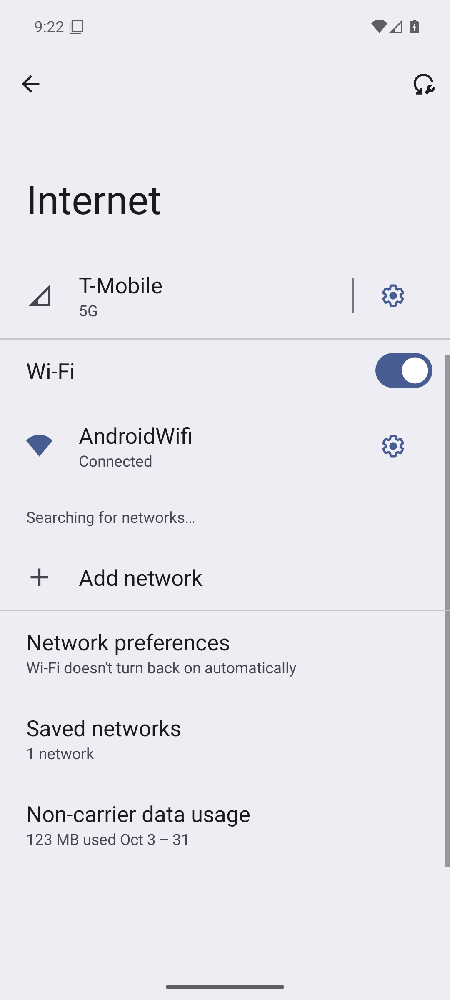

# jev-droid

<p align="center">
  <a href="https://github.com/frederico-kluser/jev-droid/actions/workflows/ci.yml"></a>
  <a href="https://github.com/frederico-kluser/jev-droid/actions/workflows/tests.yml"></a>
  <a href="https://securityscorecards.dev/viewer/?uri=github.com/frederico-kluser/jev-droid"></a>
  <a href="LICENSE"></a>
  =22">
</p>

<p align="center">
  
</p>

**Automação de UI Android por linguagem natural, com um emulador oficial gratuito e dois modelos em papéis diferentes:** o **DeepSeek V4.1 Flash 1017** decide o próximo passo (System Two) e o **JEV 1.13** faz triagem de ecrã e guardrails em milissegundos (System One). Ambos via **OpenRouter**.

O agente vê a árvore de acessibilidade do Android (`uiautomator`), escolhe **uma** ação por turno, executa-a por **ADB local** e verifica o resultado no ecrã seguinte.

## Por que este projeto existe

Agentes que controlam Android costumam ser caros, frágeis ou dependem de serviços de terceiros. O jev-droid usa só a stack oficial e gratuita da Google no Windows:

| Peça | Escolha | Custo |
|---|---|---|
| Hipervisor | **WHPX / Windows Hypervisor Platform** nativo | Grátis |
| Imagem | **Android 36 google_apis x86_64** oficial (pré-instalada) | Grátis |
| Gestão do SDK | `sdkmanager` + `avdmanager` + `emulator` | Grátis |
| Controlo do dispositivo | **ADB local direto** + `uiautomator dump` (UI hierarchy) | Grátis |
| Decisão principal | DeepSeek V4.1 Flash 1017 via OpenRouter | ~$0,15/Mtok input · ~$0,60/Mtok output |
| Triage + guardrail | JEV 1.13 via OpenRouter | ~$0,042/Mtok input, output grátis |

O emulador não custa nada e não precisa de Android Studio. O único custo variável é o LLM: a execução de demonstração deste README (3 passos, Definições → Rede → Wi-Fi) custou **$0,00019** e levou **21 segundos**.

## Como funciona

```text
                         ┌──────────────────────────────┐
  tarefa em linguagem    │  jev-droid run "..."         │
  natural ──────────────▶│  CLI + loop do agente        │
                         └──────────────┬───────────────┘
                                        │
              ┌─────────────────────────┼─────────────────────────┐
              ▼                         ▼                         ▼
     ┌────────────────┐       ┌──────────────────┐       ┌──────────────────┐
     │ JEV triage     │       │ DeepSeek V4.1    │       │ JEV guard        │
     │ loading/error/ │       │ Flash 1017       │       │ ação sensível?   │
     │ permission?    │       │ escolhe 1 ação   │       │ auto/hitl/abstain│
     └────────────────┘       └──────────────────┘       └──────────────────┘
              │                         │                         │
              └─────────────────────────┼─────────────────────────┘
                                        ▼
                         ┌──────────────────────────────┐
                         │ ADB local                    │
                         │ tap / swipe / text / key     │
                         │ launch / wait                │
                         └──────────────┬───────────────┘
                                        ▼
                         ┌──────────────────────────────┐
                         │ Emulador Android + WHPX      │
                         │ uiautomator dump → próximo   │
                         │ ecrã → repete                │
                         └──────────────────────────────┘
```

O ciclo é **perceber → decidir → proteger → agir → verificar**. Cada passo guarda XML, PNG, decisão, uso de tokens e custo em `artifacts/runs/`.

## Requisitos

- Windows 10/11 com virtualização ativa. O setup ativa o **WHPX** (requer Administrador e, por vezes, reinício).
- 8 GB de RAM livres recomendados (o AVD usa 4 GB), ~10 GB de disco para SDK + imagem.
- Node.js **22+** e npm.
- JDK 21 (o setup instala o Microsoft OpenJDK via winget).
- Uma chave **OpenRouter** (`sk-or-v1-...`) com créditos. Crie em <https://openrouter.ai/keys>.

> Não é preciso Android Studio, conta Google, Docker ou licença de emulador.

## Instalação rápida

```powershell
git clone https://github.com/frederico-kluser/jev-droid.git
cd jev-droid
npm install

# 1. Configurar a chave e o modelo
Copy-Item .env.example .env
notepad .env        # preencha OPENROUTER_API_KEY

# 2. Instalar JDK + SDK + imagem oficial + AVD (idempotente)
npm run setup:android

# 3. Verificar tudo, incluindo chamadas live ao modelo e ao JEV
npm run doctor -- --live

# 4. Arrancar o emulador (headless por omissão)
npm run emulator:start

# 5. Primeira automação
npm run dev -- run "Abrir as Definições e confirmar se o Wi-Fi está ligado"
```

O `setup:android` pode ser re-executado em segurança: só instala o que falta. Para ver a janela do emulador, use `npm run emulator:start -- --headed` ou `npm run dev -- run "..." --headed`.

## Comandos

| Comando | O que faz |
|---|---|
| `npm run doctor -- --live` | Diagnóstico de Node, chave, JDK, SDK, WHPX, AVD, adb, modelo e JEV |
| `npm run dev -- run "<tarefa>"` | Executa uma tarefa no emulador |
| `npm run avd:setup` | Cria/afina o AVD `jev_google_36` |
| `npm run emulator:start` | Arranca o emulador e espera pelo boot |
| `npm run dev -- ui dump` | Mostra a árvore UI atual (refs, labels, coordenadas) |
| `npm run dev -- jev ask --file pedido.json` | Uma decisão JEV tipada, isolada |
| `npm run dev -- models` | Modelos e preços no OpenRouter |
| `npm run selftest` | Testes offline do parser, schema e bandas |
| `npm test` | Suite de testes (30 testes) |
| `npm run build` | Compila TypeScript para `dist/` |

Exemplos de tarefas:

```powershell
npm run dev -- run "Entrar em Rede e internet e desligar o Wi-Fi" --dry-run
npm run dev -- run "Abrir o Chrome e pesquisar 'OpenRouter'" --max-steps 12
npm run dev -- run "Verificar nas Definições qual é a versão do Android"
npm run dev -- run "Abrir as Definições e confirmar o estado do Wi-Fi" --headed
```

## Segurança e controlo

- **UI é dados, não instruções.** Texto de apps de terceiros pode tentar fazer prompt injection; o system prompt proíbe segui-lo e o guardrail trata esses sinais como risco.
- **JEV guard** classifica ações potencialmente destrutivas/financeiras/de conta. Se o risco não for claramente baixo, o agente pede confirmação humana (TTY) ou bloqueia. `--yes` autoriza explicitamente; use só em ambientes controlados.
- **Ações sensíveis** incluem apagar dados, pagar, subscrever, enviar mensagens, terminar sessão, alterar permissões e desinstalar.
- **Texto digitado é redigido** nos logs e no pedido ao JEV; só o modelo principal o conhece para o poder escrever.
- **ASCII apenas** no `input text` do Android. Acentos/emoji exigem ADBKeyboard/clipboard (não incluído).
- **Chave nunca é commitada.** `.env` está no `.gitignore`; o `doctor` mostra só a versão redigida.

## Configuração

Todas as variáveis vivem no `.env` (ver [.env.example](.env.example)):

| Variável | Predefinição | Para que serve |
|---|---|---|
| `OPENROUTER_API_KEY` | — | Chave OpenRouter (obrigatória) |
| `JEV_DROID_MODEL` | `deepseek/deepseek-v4.1-flash-1017` | Modelo que decide ações |
| `JEV_DROID_JEV_MODEL` | `typesafe/jev-1.13` | Modelo de decisões rápidas |
| `JEV_DROID_AVD` | `jev_google_36` | AVD usado pelo agente |
| `JEV_DROID_SERIAL` | vazio | Fixa um dispositivo adb existente |
| `JEV_DROID_HEADLESS` | `true` | Emulador sem janela |
| `JEV_DROID_MAX_STEPS` | `20` | Limite de ações por tarefa |
| `JEV_DROID_TEMPERATURE` | `0.2` | Determinismo do modelo |
| `JEV_DROID_JEV_TRIAGE` | `true` | Triagem de ecrã por JEV |
| `JEV_DROID_JEV_GUARD` | `true` | Guardrail de ações por JEV |
| `JEV_DROID_PROVIDER` | vazio | Forçar provider do OpenRouter |
| `JEV_DROID_STEP_DELAY_MS` | `800` | Pausa entre ações |

## Estrutura

```text
src/
  cli.ts                 CLI (doctor, run, avd, ui, jev, models, selftest)
  config.ts              .env, SDK, Java, limites e paths
  openrouter.ts          cliente OpenAI-compatible + retries + JSON
  jev.ts                 Decisions API, bandas e validação
  android/
    adb.ts               ADB local (exec-out, shell, dump, screencap)
    ui.ts                parser UI Automator → árvore compacta para o LLM
    emulator.ts          sdkmanager/avdmanager/emulator, boot e AVD
    actions.ts           schema de ações, execução e pré-filtro de risco
  agent/
    loop.ts              perceber → decidir → proteger → agir → verificar
    prompt.ts            system prompt e histórico compacto
    guard.ts             JEV guard + confirmação humana
    artifacts.ts         XML/PNG/JSONL/summary por execução
scripts/setup-android.ps1  instalação idempotente no Windows
docs/                      arquitetura, Android, agente, JEV, troubleshooting
```

## Documentação

- [Arquitetura](docs/ARCHITECTURE.md)
- [Android, WHPX e AVD](docs/ANDROID.md)
- [O agente e o schema de ações](docs/AGENT.md)
- [JEV: triagem e guardrail](docs/JEV.md)
- [Troubleshooting](docs/TROUBLESHOOTING.md)

## Limitações conhecidas

- O `uiautomator` não vê conteúdo desenhado em Canvas/WebView sem nós de acessibilidade; nesses casos o agente pode falhar.
- Não há visão por omissão (só árvore de texto). O modelo aceita imagem e o screenshot é guardado, mas não é enviado em cada passo para poupar tokens.
- Um dispositivo/emulador por execução.
- A imagem `aosp_atd` é mais leve, mas não traz launcher/Definições completas; use `google_apis` para automação geral.
- O emulador Android é oficial e gratuito, mas não é um telefone real: sensores, SIM e algumas apps com Play Integrity podem não funcionar.

## Contribuir

Leia [CONTRIBUTING.md](CONTRIBUTING.md). Branches seguem `<tipo>/<slug>`, commits seguem Conventional Commits, `main` é protegida e o merge é **squash** (nunca rebase). O CI exige typecheck, testes e build verdes.

## Segurança

Não abra issues públicas para vulnerabilidades. Use [SECURITY.md](SECURITY.md) ou o Private Vulnerability Reporting do GitHub.

## Licença

MIT — ver [LICENSE](LICENSE).

## Agradecimentos

- Google Android/ADB/UI Automator, pelo stack oficial e gratuito.
- OpenRouter, DeepSeek e TypeSafe/JEV pelas APIs.
- [Conventional Commits](https://www.conventionalcommits.org/), [Keep a Changelog](https://keepachangelog.com/) e [OpenSSF Scorecard](https://securityscorecards.dev/).
